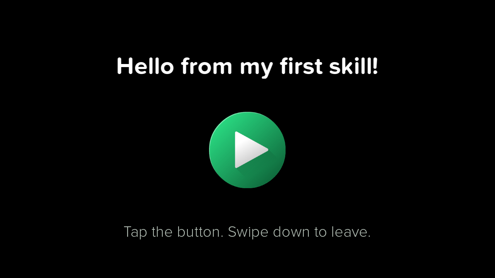

You'll build **Hello Jibo**: a screen with a title and a button. Tap the button and Jibo says hello with a happy animation; swipe down to leave. It also opens when you say "Hey Jibo, say hello world".

[Download the finished ZIP](/downloads/hello-jibo.zip) if you want to try it first. The source is in the [docs repository](https://github.com/JRG5x1/docs/tree/main/examples/hello-jibo).



## 1. Make the folders

```text
hello-jibo/
  manifest.json      what the Store and BEacon read
  icon.png           the main-menu button icon
  README.md          shown in BEacon's Store details
  hello/
    package.json     the skill package
    index.html       loads the skill
    index.js         your code
```

## 2. manifest.json

```json
{
  "name": "Hello Jibo",
  "version": "1.0.0",
  "supported": "3.2.0",
  "type": "skill",
  "buttonColor": "#29D780 #0F6B3D",
  "phrases": ["say hello world"]
}
```

- `supported` must be `3.2.0` or newer, or Jibo turns the skill off.
- `buttonColor` is the menu button's colour: two colours make a gradient.
- `phrases` are launch phrases: "Hey Jibo, say hello world" opens it. See [Launch phrases](/skills/phrases/).

## 3. hello/package.json

```json
{
  "name": "@be/hello-jibo",
  "version": "1.0.0",
  "main": "index.js",
  "config": { "standalone": true },
  "jibo": { "main": "index.html", "type": "asset-pack", "display-name": "hello-jibo", "prompt": "Hello Jibo" }
}
```

The package name must be `@be/` plus a name nobody else uses. It's your skill's ID.

## 4. hello/index.html

Every skill uses the same small page:

```html
<!DOCTYPE html>
<html>
<head>
    <meta charset="utf-8">
    <title>Hello Jibo</title>
    <style>
        body { margin: 0; overflow: hidden; background: #000; }
        #face { width: 1280px; height: 720px; }
    </style>
</head>
<body>
    <div id="face"></div>
    <script>const Skill = require('./index'); const skill = new Skill();</script>
</body>
</html>
```

## 5. hello/index.js

```js
'use strict';

const jibo = require('jibo');
const BeSkill = require('@be/be-framework').BeSkill;

class HelloJibo extends BeSkill {
    // Called every time the skill opens: from its menu button, a launch phrase, or another skill.
    open(result) {
        const views = jibo.face.views;
        const view = views.createView('View', {
            viewConfig: { type: 'View', id: 'hello-jibo', category: 'gui', ignoreSwipeDown: true },
            componentConfigs: [
                { type: 'Label', id: 'title', text: 'Hello from my first skill!',
                  position: { x: 640, y: 170 }, targetAnchor: { x: 0.5, y: 0.5 },
                  style: { fontFamily: 'Proxima Nova Soft', fontSize: 64, fill: '#FFFFFF', fontWeight: 'bold' } },
                { type: 'ActionButton', id: 'talk', iconSrc: 'jibo://resources/actionIcons/play.png',
                  colors: [0x29D780, 0x0F6B3D], position: { x: 541, y: 290 }, transform: { scaleX: 0.75, scaleY: 0.75 },
                  action: { type: views.ActionData.CALLBACK, data: { callback: () => this.talk() } } },
                { type: 'Label', id: 'hint', text: 'Tap the button. Swipe down to leave.',
                  position: { x: 640, y: 600 }, targetAnchor: { x: 0.5, y: 0.5 },
                  style: { fontFamily: 'Proxima Nova Light', fontSize: 40, fill: '#B0BBB2' } }
            ]
        });
        // Swipe down = leave, like every Jibo screen.
        view.addAction(views.ActionData.CALLBACK, { callback: () => this.exit({ noElementsOfSurprise: true }) },
            true, false, views.GESTURE.SWIPE_DOWN);
        views.changeView({ addView: view });
    }

    // Jibo speaks with ESML: plain text plus tags for animations, emojis and sounds.
    talk() {
        jibo.embodied.speech.speak("Hello! <anim cat='happy' nonBlocking='true' /> I'm running your very first skill.")
            .catch(err => this.log.warn('speech failed', err));
    }

    // Called when the skill closes. Remove your screen, stop timers and sounds, then call done().
    close(done) {
        jibo.tts.stop();
        jibo.face.views.changeView({ removeAll: true, leaveEmpty: true }, () => done(), () => done());
    }
}

module.exports = HelloJibo;
```

What's going on:

- Your class extends `BeSkill`. Jibo calls `open()` when the skill starts and `close(done)` when it ends. See [Lifecycle](/skills/api/lifecycle/).
- The screen is a **view** made of components (`Label`, `ActionButton`, …) positioned on Jibo's 1280×720 screen. See [Screen and touch](/skills/api/screen/).
- `this.exit()` tells Jibo you're done; he closes the skill and goes back to his eye.
- `jibo.embodied.speech.speak()` makes him talk and move. See [Speech and animation](/skills/api/speech-and-animation/).

## 6. An icon and a README

`icon.png` is required: a square PNG (330×330 works well), white artwork on a transparent background. Jibo draws it on a round button in your `buttonColor`. `README.md` is shown in BEacon's Store details; its first paragraph is the card text.

## 7. Zip it

Zip the **contents** of `hello-jibo/` so `manifest.json` is at the top of the ZIP (one enclosing folder is fine too):

```sh
cd hello-jibo
zip -r ../hello-jibo.zip manifest.json icon.png README.md hello
```

## 8. Install it

1. Open BEacon (`http://<jibo-ip>:8123`) and go to **Store**.
2. Open the three-dot menu and choose **Upload ZIP**, then pick `hello-jibo.zip`.
3. BEacon shows a "Just so you know" notice for skills from outside the Store. Confirm, and it installs.

Hello Jibo is now the first button in Jibo's main menu. Open it, tap the button, then swipe down. Or say "Hey Jibo, say hello world".

To change something, edit, zip and upload again. The new version runs the next time the skill opens. [Install and test](/testing/install-and-test/) shows how to do this with one command.

## Next

- [Anatomy of a skill](/skills/anatomy/): every file and field
- [Skill API](/skills/api/lifecycle/): everything a skill can do
- [Publish to the 5x1 Store](/themes/publishing/)
