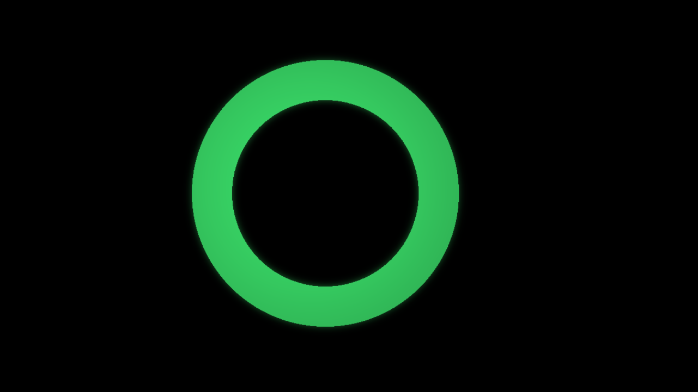

A theme is a ZIP of JSON files and pictures. It never runs code, so it is a safe place to start. In this tutorial you will give Jibo a glowing green ring for an eye, install it on your robot, and switch back to the stock look.

You need a text editor, an image editor (or the small Python script below), and a Jibo running 5x1 3.2.0 or newer on your network.

## 1. Lay out the files

Make a folder called `green-eye` with this inside:

```text
green-eye/
├── manifest.json
├── README.md           optional: description shown in the Store
├── banner.png          optional: 16:9 picture for the Store card
└── face/
    ├── face.json
    ├── eye.png
    └── eyeClosed.png   optional: the eye when Jibo blinks
```

[Download the finished ZIP](/downloads/green-eye.zip) to try it first. The source is in the [docs repository](https://github.com/JRG5x1/docs/tree/main/examples/green-eye).



## 2. Write the manifest

`manifest.json` names your theme. Every theme needs one.

```json
{
  "name": "Green Eye",
  "version": "1.0.0",
  "supported": "3.2.0",
  "type": "theme"
}
```

- `name` identifies the theme. Installing a theme with the same name replaces the old one.
- `version` must be a semantic version like `1.0.0`. Raise it each time you share a new copy.
- `supported` is the oldest 5x1 version your theme works with. Robots on an older version refuse to install it.
- `type` is always `"theme"` for themes.

## 3. Configure the face

`face/face.json` sets the background color and the eye's size:

```json
{
  "backgroundColor": "#000000",
  "eyeSize": 90
}
```

`eyeSize` is a percentage of the stock eye, so `90` is a little smaller than normal. Colors are written as `#RRGGBB`. Every field is optional; unknown fields are rejected.

## 4. Draw the eye

`face/eye.png` replaces Jibo's eye. Draw it **square**, with the eye on a **transparent background**: the picture is stretched onto the eye's shape, so a square image keeps its proportions, and anything outside your eye should be see-through. 512 × 512 pixels is plenty.

`face/eyeClosed.png` is optional. As Jibo blinks, pets or falls asleep, the eye squashes and this picture fades in. Without it, the open eye is used.

This Python script (it needs [Pillow](https://pillow.readthedocs.io/)) draws both pictures and a banner:

```python
from PIL import Image, ImageDraw, ImageFilter

SIZE = 512
GREEN = (60, 230, 110, 255)

def eye(closed=False):
    im = Image.new("RGBA", (SIZE, SIZE), (0, 0, 0, 0))  # transparent background
    d = ImageDraw.Draw(im)
    if closed:
        d.rounded_rectangle((56, SIZE // 2 - 22, SIZE - 56, SIZE // 2 + 22), radius=22, fill=GREEN)
    else:
        d.ellipse((24, 24, SIZE - 24, SIZE - 24), outline=GREEN, width=70)
    glow = im.filter(ImageFilter.GaussianBlur(10))
    return Image.alpha_composite(glow, im)

eye().save("face/eye.png")
eye(closed=True).save("face/eyeClosed.png")

banner = Image.new("RGBA", (1280, 720), (0, 0, 0, 255))
banner.alpha_composite(eye().resize((440, 440)), (420, 140))
banner.save("banner.png")
```

Run it from inside the `green-eye` folder (create `face/` first).

## 5. Add a README (optional)

The first paragraph of `README.md` becomes the description on the Store card, and the whole file shows in the theme's details.

```markdown
# Green Eye

A simple example theme that gives Jibo a glowing green ring for an eye.

Free to copy and change.
```

## 6. Zip it

`manifest.json` must sit at the top of the ZIP, or inside **one** folder. Either of these works:

```text
manifest.json              green-eye/manifest.json
face/face.json             green-eye/face/face.json
face/eye.png               green-eye/face/eye.png
...                        ...
```

A ZIP with the manifest two folders deep, or with more than one manifest, is rejected.

On macOS or Linux, from inside the `green-eye` folder:

```sh
zip -r ../green-eye.zip manifest.json README.md banner.png face
```

On Windows, select the files and the `face` folder inside `green-eye`, then right-click and choose **Send to → Compressed (zipped) folder**. Zipping the `green-eye` folder itself also works.

Without the `zip` tool, Python can do it:

```sh
python3 -c "import shutil; shutil.make_archive('../green-eye', 'zip', '.')"
```

## 7. Upload it in BEacon

1. Open BEacon in a browser: `http://<jibo-ip>:8123`.
2. Go to **Store** and make sure **Themes** is selected.
3. Open the three-dot menu beside the switch and choose **Upload ZIP**.
4. Pick `green-eye.zip`.

BEacon checks the ZIP before installing it. If something is wrong you get an error saying what, for example `Invalid face.json` or `Unknown face.json field: eyeColor`. Fix it, zip again and upload again.

Uploading installs the theme but does not change Jibo yet.

## 8. Apply and check

Find the **Green Eye** card and press **Apply**. Watch Jibo:

- The eye is a green ring, slightly smaller than normal.
- It still moves, blinks and changes shape with his animations.
- When he blinks, the green bar from `eyeClosed.png` fades in.

To change something, edit the files, zip and upload again. A new upload with the same name replaces the installed copy, but the old one stays on screen until you press **Apply** again.

## 9. Go back to stock

Press **Apply** on the **None** card (always the first one). Jibo's stock eye, menus and sounds come back. To delete your theme, press **Remove** on its card.

## Next steps

- Add a menu look, icons, animation art and sounds: see the [Theme reference](/themes/reference/).
- Share your theme with every 5x1 robot: see [Publishing to the 5x1 Store](/themes/publishing/).
